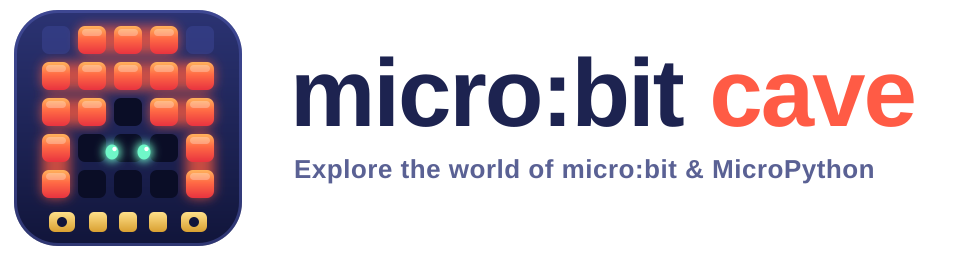

<p align="center">
<picture>
  <source media="(prefers-color-scheme: dark)" srcset="docs/assets/images/logo-wordmark-dark.svg">
  
</picture>
</p>

<p align="center">
  <a href="https://meqdaddev.github.io/microbit-cave/"></a>
  <a href="https://github.com/MeqdadDev/microbit-cave/actions/workflows/docs.yml"></a>
  
  <a href="LICENSE"></a>
</p>

<p align="center">
  <b>Hands-on MicroPython projects for the BBC micro:bit</b>, from your first scrolling message to sensors,
  displays, motors and two-way communication. Every project is tested on real hardware (micro:bit V2).
</p>

<p align="center">
  <a href="https://meqdaddev.github.io/microbit-cave/"><b>Explore the documentation website</b></a>
  ·
  <a href="https://meqdaddev.github.io/microbit-cave/getting-started/">Getting started</a>
  ·
  <a href="https://meqdaddev.github.io/microbit-cave/contributing/">Contributing</a>
</p>

## What's inside

Each project has a page on the [website](https://meqdaddev.github.io/microbit-cave/) with the parts you need,
a wiring diagram, the full code, a line-by-line explanation and ideas to try next.

### micro:bit built-ins

Projects that need nothing but a micro:bit.

| Project | What it does | Board | Code |
|---------|--------------|-------|------|
| [Display Text](https://meqdaddev.github.io/microbit-cave/microbit/01-display-text/) | Scroll a message and show a heart | V1 & V2 | [.py](microbit/1%20display%20string.py) |
| [Built-in Images](https://meqdaddev.github.io/microbit-cave/microbit/02-display-images/) | Cycle through hearts, faces and moods | V1 & V2 | [.py](microbit/2%20display%20images.py) |
| [DIY Images](https://meqdaddev.github.io/microbit-cave/microbit/03-display-diy-images/) | Draw your own picture LED by LED | V1 & V2 | [.py](microbit/3%20display%20DIY%20images.py) |
| [Radio Messaging](https://meqdaddev.github.io/microbit-cave/microbit/04-radio-messaging/) | Send a message from one micro:bit to another | V1 & V2 | [sender](microbit/4%20radio-sender.py) · [receiver](microbit/5%20radio-receiver.py) |
| [Light Sensor](https://meqdaddev.github.io/microbit-cave/microbit/06-light-level/) | Tell day from night with the LED matrix | V1 & V2 | [.py](microbit/6%20light-level.py) |
| [Dice](https://meqdaddev.github.io/microbit-cave/microbit/07-random-dice/) | Shake to roll a random number | V1 & V2 | [.py](microbit/7%20random-lib1.py) |
| [Challenges](https://meqdaddev.github.io/microbit-cave/microbit/08-random-challenges/) | Press A for a random party challenge | V1 & V2 | [.py](microbit/8%20random-lib2.py) |
| [Data Logging](https://meqdaddev.github.io/microbit-cave/microbit/09-data-logger/) | Record temperature to the on-board log | V2 | [.py](microbit/9%20data-logger.py) |
| [Serial Communication](https://meqdaddev.github.io/microbit-cave/microbit/10-serial-communication/) | Stream sensor data to your computer and reply | V1 & V2 | [micro:bit](microbit/10%20microbit%20serial%20sender.py) · [computer](microbit/10%20microbit%20serial.py) |
| [Digital Compass](https://meqdaddev.github.io/microbit-cave/microbit/11-compass/) | A needle that always points north | V1 & V2 | [.py](microbit/11%20compass.py) |
| [Spirit Level](https://meqdaddev.github.io/microbit-cave/microbit/12-spirit-level/) | An LED ball that rolls as you tilt | V1 & V2 | [.py](microbit/12%20spirit-level.py) |
| [Clap Switch](https://meqdaddev.github.io/microbit-cave/microbit/13-clap-switch/) | Clap to switch an LED lamp on and off | V2 | [.py](microbit/13%20clap-switch.py) |
| [Music Jukebox](https://meqdaddev.github.io/microbit-cave/microbit/14-music/) | Melodies, your own tune and a siren | V1 & V2 | [.py](microbit/14%20music.py) |
| [Fruit Piano](https://meqdaddev.github.io/microbit-cave/microbit/15-fruit-piano/) | Play notes by touching fruit | V2 | [.py](microbit/15%20fruit-piano.py) |

### Sensors & modules

Projects that wire external hardware to the micro:bit. Helper libraries live next to each example.

| Project | What it does | Board | Code |
|---------|--------------|-------|------|
| [LED and Buzzer](https://meqdaddev.github.io/microbit-cave/tools/led-buzzer/) | Switch an LED or buzzer with button A | V1 & V2 | [folder](microbit_tools/LED%20and%20Buzzer/) |
| [PIR Sensor](https://meqdaddev.github.io/microbit-cave/tools/pir-sensor/) | Motion alarm with a buzzer | V1 & V2 | [folder](microbit_tools/PIR%20Sensor/) |
| [Ultrasonic Sensor](https://meqdaddev.github.io/microbit-cave/tools/ultrasonic-sensor/) | Measure distance (3 V and 5 V modules) | V1 & V2 | [folder](microbit_tools/Ultrasonic%20Sensor/) |
| [Servo Motor](https://meqdaddev.github.io/microbit-cave/tools/servo-motor/) | Turn a 9g servo with the buttons | V1 & V2 | [folder](microbit_tools/Servo%20Motor/) |
| [OLED Screen](https://meqdaddev.github.io/microbit-cave/tools/oled-screen/) | Print text on an SSD1306 display | V1 & V2 | [folder](microbit_tools/OLED%20Screen/) |
| [DHT11 Sensor](https://meqdaddev.github.io/microbit-cave/tools/dht11-sensor/) | Read temperature and humidity | V2 | [folder](microbit_tools/DHT11%20Sensor/) |
| [IR Receiver](https://meqdaddev.github.io/microbit-cave/tools/ir-receiver/) | Decode buttons from an IR remote | V1 & V2 | [folder](microbit_tools/IR%20Receiver/) |

## Quick start

1. Open the [micro:bit Python Editor](https://python.microbit.org/) in your browser.
2. Paste the code of any project and connect your micro:bit with a USB cable.
3. Click **Send to micro:bit**.

Sensor projects that import a helper (like `servo.py`) need that file on the micro:bit too.
The [getting started guide](https://meqdaddev.github.io/microbit-cave/getting-started/#copying-helper-libraries)
shows how.

## Repository layout

```text
microbit/          projects that use only the micro:bit
microbit_tools/    one folder per sensor or module: example + helper library
docs/              website pages (MkDocs Material), one page per project
templates/         the page template for new projects
```

## Contributing

Pull requests are welcome! For major changes, please open an issue first to discuss what you would like to change.

- **Test on real hardware:** please test your code on a real micro:bit before opening a PR.
- **Avoid duplicates:** check the existing projects first.
- **Add a docs page:** every project also needs a page on the website, made from
  [`templates/example-page.md`](templates/example-page.md). The [contributing guide](https://meqdaddev.github.io/microbit-cave/contributing/)
  explains the folder layout and how the wiring diagram is generated.

Every pull request builds the website to catch mistakes, and merging to `main` publishes it automatically.

## License

[MIT](LICENSE) © Meqdad Darwish
