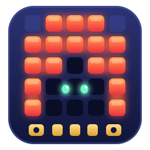

<h1>micro:bit cave</h1>

Explore the world of micro:bit &amp; MicroPython — hands-on projects, sensors and modules, each one tested on real hardware.

[Get started](getting-started.md){ .md-button .md-button--primary }
[Browse projects](microbit/index.md){ .md-button }

-   :material-led-on:{ .lg .middle } __micro:bit Built-ins__

    ---

    The LED matrix, buttons, radio, accelerometer, light and temperature — no extra parts.

    [:octicons-arrow-right-24: Explore built-ins](microbit/index.md)

-   :material-chip:{ .lg .middle } __Sensors & Modules__

    ---

    Ultrasonic, PIR, DHT11, OLED, servo, IR remote and more, with wiring tables and libraries.

    [:octicons-arrow-right-24: Explore modules](tools/index.md)

-   :material-rocket-launch:{ .lg .middle } __Getting Started__

    ---

    Flash your first MicroPython program and learn how to copy helper libraries onto the board.

    [:octicons-arrow-right-24: Start here](getting-started.md)

-   :material-source-pull:{ .lg .middle } __Contribute__

    ---

    Add your own tested project — every example follows the same simple template.

    [:octicons-arrow-right-24: Contributing guide](contributing.md)

