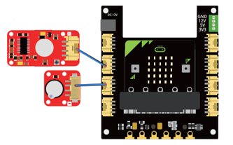

## What you'll build

Build a simple motion alarm: when the PIR sensor sees movement, the buzzer sounds.

## Wiring

<!-- wiring -->



## Code

```python title="pir-buzzer.py" linenums="1"
--8<-- "microbit_tools/PIR Sensor/pir-buzzer.py"
```

## How it works

A PIR (passive infrared) sensor outputs `1` while it detects a moving warm body. `pin2.read_digital()` reads that,
and the buzzer on pin 1 mirrors it.

## Try this next

- Show `Image.SURPRISED` on the display when motion is detected.
- Count how many times motion was detected and scroll the total with button A.
- Send an alert to another micro:bit over [radio](../microbit/04-radio-messaging.md).
